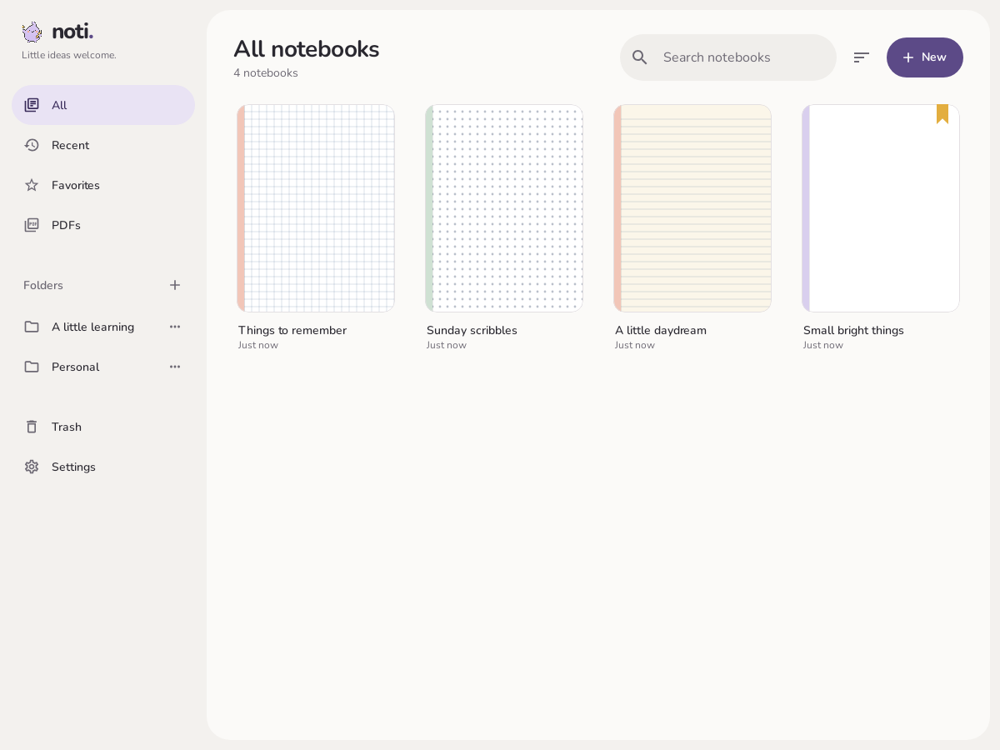
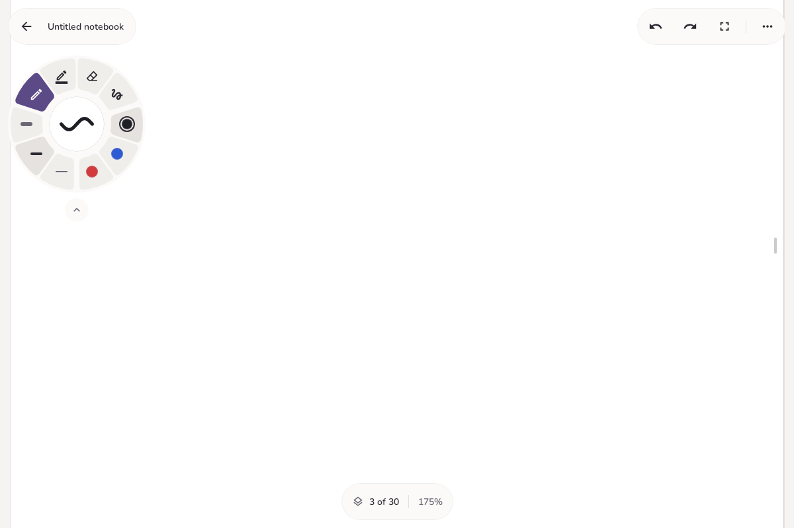
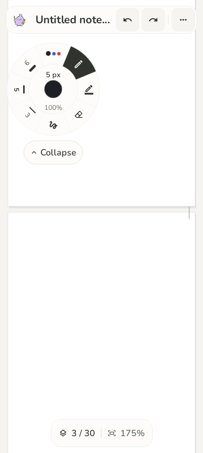
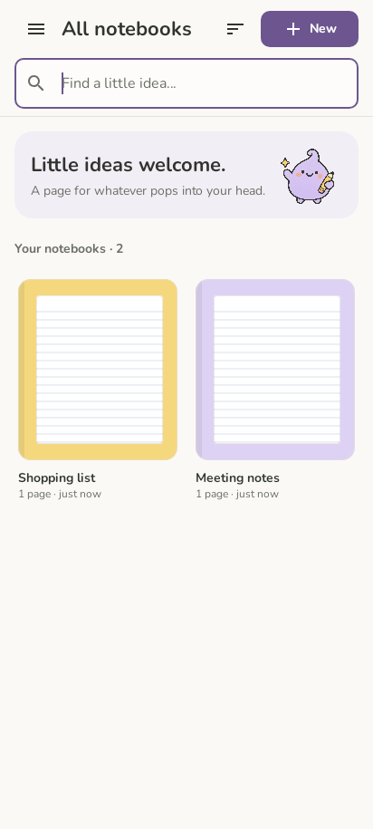
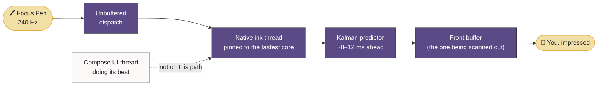
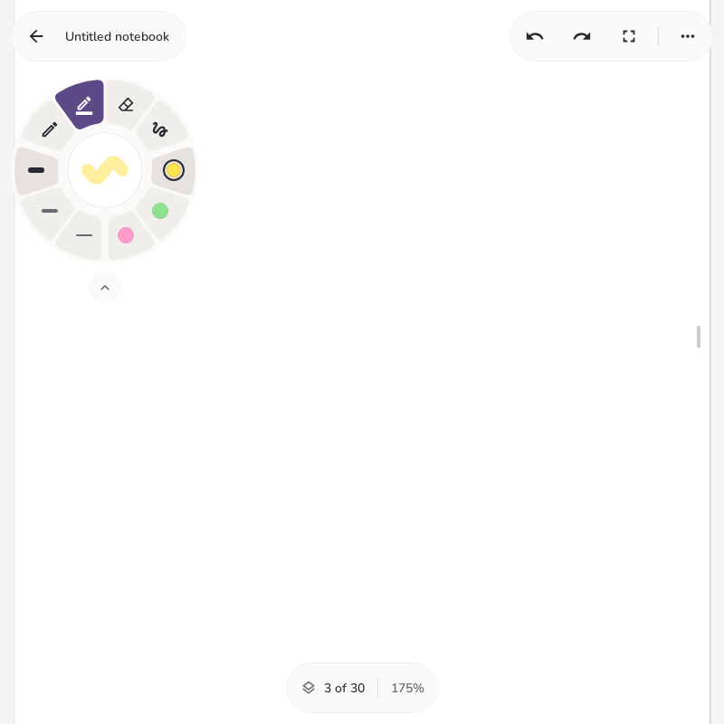

<div align="center">


<picture>
  <source media="(prefers-color-scheme: dark)" srcset="docs/branding/assets/noti-wordmark-dark.svg">
  
</picture>

### Little ideas welcome.

*A quiet home for notes, PDFs and happy scribbles.*
*Your pen is faster than your thoughts now. Sorry in advance.*

<br>

[](https://github.com/mariajunqueiramirandas-cpu/Noti/releases/latest)
[](https://github.com/mariajunqueiramirandas-cpu/Noti/actions/workflows/release-apk.yml)


[**The ink engine**](engine/README.md) ·
[**Palm rejection**](docs/PALM_REJECTION.md) ·
[**Pen buttons**](docs/PEN_BUTTONS.md) ·
[**Study boards**](docs/STUDY_BOARD.md) ·
[**Type on lines**](docs/TYPE_ON_LINES.md) ·
[**Latency plan**](docs/LOW_LATENCY_PLAN.md) ·
[**Brand guide**](docs/branding/README.md)

</div>

---

## ✏️ What is this?

Noti is a handwriting, note-taking and PDF-annotating app built for the **Xiaomi Pad 7 + Xiaomi Focus Pen**,
with one unreasonable goal: **it should feel like writing on paper.** Not "paper-like". Not "inspired by paper".
Paper. The kind your ink lands on *right now*, not two frames from now after the UI thread finishes its coffee.

To get there we wrote a native C++ ink engine, a pen-motion predictor, a palm-rejection system with
actual statistics in it, and a cheerful lavender mascot. Priorities.

<table>
<tr>
<td width="33%" align="center">⚡<br><b>Fast ink</b><br><sub>Front-buffer rendering, a tuned predictor, and a UI thread that is politely not invited.</sub></td>
<td width="33%" align="center">✋<br><b>Your palm is not a pen</b><br><sub>A sequential probability test decides that, usually before you've noticed you put it down.</sub></td>
<td width="33%" align="center">🍩<br><b>One dial to rule the tools</b><br><sub>Twelve segments. Every preset is one tap. The plum one is the boss.</sub></td>
</tr>
<tr>
<td align="center">📄<br><b>PDFs that keep up</b><br><sub>Tiled rendering, pinch from 25% to 600%, ink that stays glued to the page.</sub></td>
<td align="center">🖊️<br><b>Pen buttons, reclaimed</b><br><sub>The Focus Pen's buttons do Noti things now (on Pad 7, Android 16, after a polite word with HyperOS).</sub></td>
<td align="center">💾<br><b>Saves on its own</b><br><sub>Atomic, versioned, autosaved between strokes. Your notes are safe.</sub></td>
</tr>
<tr>
<td align="center">🔤<br><b>Handwriting to text</b><br><sub>Loop it, read it, copy it or swap it for neat typed ink. On the tablet, offline, no account.</sub></td>
<td align="center">⌨️<br><b>Type on lines</b><br><sub>Loop the lines on a PDF and type. The text sits on them, sized to fit, even on a crooked scan.</sub></td>
<td align="center">🎓<br><b>Study boards</b><br><sub>Link a PDF, get math and physics questions on a floating sheet, work them on the board, loop to check, print the keepers.</sub></td>
</tr>
</table>

## 📸 Look at it go

<div align="center">

<picture>
  <source media="(prefers-color-scheme: dark)" srcset="docs/branding/screenshots/library-dark.png">
  
</picture>

<sub>The library. Every notebook cover is its real first page. We refuse to invent content you didn't write.</sub>

<br><br>





<sub>The editor (with its one bold element, the dial) and the phone layouts, which are tested down to 360 dp with 1.5× text. Yes, really.</sub>

</div>

## ⚡ Why is the ink so fast?

Because most Android apps lose **20–50 ms** in software between your nib and the pixel, and software is the
part we're allowed to fix.

| | Typical Android app | Noti's target |
|---|:---:|:---:|
| Waiting for vsync batching | 0–7 ms | **~0 ms** (unbuffered dispatch) |
| UI thread doing UI things | 0–20+ ms of surprise | **~0 ms** (ink never waits on it) |
| Drawing the stroke | 1–5 ms | **< 0.5 ms** (only the new segment) |
| BufferQueue + SurfaceFlinger | 14–21 ms at 144 Hz | **0 ms** (front-buffer rendering) |
| **Total, measured** | **~30–60 ms** | **~10–16 ms** |
| **Perceived, with prediction** | — | **≈ 0–5 ms** |

<sub>Targets from the <a href="docs/LOW_LATENCY_PLAN.md">low-latency plan</a>, not marketing. The digitizer, the scan-out and the LCD are physics;
we can't remove them, so the predictor draws ink where the nib is <i>about</i> to be. Apple quotes about 9 ms for Pencil on iPad Pro. Just saying.</sub>



The engine also runs with battery life and thermals **explicitly out of scope** while the canvas is on screen: the ink thread
sits on the fastest core, a heater thread keeps that core from ever dozing off, and the GPU gets poked every 4 ms so it never
naps either. Your tablet may get warm. That's the ink being enthusiastic. Details in the [engine README](engine/README.md).

## 🍩 The dial



The editor is a full canvas with a small pill header and a persistent **radial tool dial** at the upper left.
Twelve rounded segments, three groups, read clockwise:

- **Top:** pen, highlighter, stroke eraser, lasso, transcribe, type
- **Right:** your three saved colors
- **Left:** three width presets

Every preset is one tap, and the *whole* segment responds, not just the tiny icon (we've all suffered). The active tool is a plum
segment that glides to the next one when you switch, because things should be a little bit delightful.

The hub is a tiny page that previews the stroke you'll get, in its real color and relative width (or shows the eraser,
the lasso and the selection count). **Tap the hub** for full color, width and pressure controls. **Drag it** to move the dial.
**Tap the chevron** to shrink it to a 56 dp draggable button with a bead of your current color; tap again to bring it back,
centered where it was. The chosen tool stays active while collapsed. More → Collapse tools / Expand tools does the same.

<br clear="right">

### 🔤 Handwriting to text

Pick **Transcribe** (the **Tt** segment) and draw a loop around some handwriting. Noti reads it and opens a panel with the text,
where you can fix anything it misread, then:

- **Copy** it, to paste anywhere.
- **Replace on page**, which swaps the handwriting for tidy typed ink in Nunito, in your ink's color, line by line where you wrote
  it. It's still ink: erase it, lasso it, move it. **Undo** brings your handwriting back.

Reading happens on the tablet with Google's ML Kit digital ink recognizer. The first time, it downloads the language's model
(about 20 MB); after that it works offline and your notes never leave the device. It follows the device language; pick another
in **Settings → Writing → Handwriting language**. Highlighter strokes in the loop are left out, and the lines are worked out from
the ink itself, so dots, accents and descenders stay on the line they belong to.

### ⌨️ Type on lines

Got a PDF with lines on it? A worksheet, a form, an exam with answer lines, a crooked phone scan? Pick **Type** (the
keyboard segment), **loop the lines** or **tap one**, and type. Noti finds the lines in the page's pixels, numbers
them, and your text lands **on** them: sized to the spacing, starting after `Name:`, wrapping by words, never past a
line's end, and tilted along with a tilted scan.

- **Tap a line** to leave it out or bring it back. Too much text? **Shrink to fit** or **Keep going** below.
- **More → Fill this page** turns every blank into a field; **Tab** through them like a web form.
- **Quick fills** (Settings → Writing) put your name, student number or today's date on the line in one tap.
- **Write** with the pen in the panel instead, and it's read on the tablet and lands as tidy text.
- **Tap typed text** to edit it later, even after you've moved it. With any other tool it's just ink.

Table cells, boxes, combs (one character per box), dotted leaders and Noti's own lined paper work too. Exported PDFs
keep the words searchable. All on the tablet, offline. Details in [docs/TYPE_ON_LINES.md](docs/TYPE_ON_LINES.md).

### 🎓 Study boards

**New → Study board** makes an endless canvas that studies a PDF with you. Link one from the library, and Mistral
Large 4 turns it (or a page range, or notes you loop on the board) into **math and physics** questions, multiple
choice, problems and flash cards. They stream onto a **floating sheet** over the board:

- **Work it on the board**, then **Check**: loop your work and get a red-pen verdict, feedback and a ✓ or ✗ per step.
- **Multiple choice** is checked on the tablet. **Flash cards** flip and get rated.
- **Hints** come one at a time. **Answer** shows the worked solution. **Source** shows the cited page and can lay
  it on the board.
- **Print** pins the item to the board exactly where, and as big as, the sheet showed it. The sheet steps aside
  until **Study** in the top bar brings it back on what's due.

Reviews are spaced with FSRS. There are timed exams with a printable score card, and a button that arranges
printed cards in columns by topic. Export PDF includes the cards.

It uses **your own Mistral API key** (Settings → Study), encrypted on the tablet. Nothing leaves the tablet unless
you ask, and uploaded PDFs are deleted from Mistral once the questions are made. Details are in
[docs/STUDY_BOARD.md](docs/STUDY_BOARD.md).

<details>
<summary><b>🔧 How the floating bits stay out of the ink's way</b></summary>

<br>

Floating controls use sub-panel popup windows above the native ink input panel, so taps reach them without changing the
low-latency drawing path (`ui/common/InkCanvas.kt`). Export PDF, Page paper and Settings are in More. Compact floating
controls group notebook navigation and editing history at the top; a single bottom dock groups the page counter and live zoom.
Tablet layouts offer a direct full-screen button.

App buttons, chips, menus and dialogs share the action styles and explicit-width, scrollable dialog frame in
`ui/common/Controls.kt`. Actions are pills: primary plum, secondary outlined, quiet neutral, and permanent deletion uses the
destructive role. Dialog titles and actions stay visible while forms scroll.

</details>

## 🖊️ The pen buttons

The Focus Pen has buttons. Noti uses them.

| You do this | Noti does this |
|---|---|
| Click the **writing button** | Toggle the eraser. Click again to go back to your last pen/highlighter. |
| Click the **screenshot button** | Toggle the lasso. Same deal. |
| **Hold** the writing button and touch the page | Open the dial right under the nib. Drag to a tool, color or width and lift to pick it. Lift on the centre to cancel, or on the lock to keep it open. |
| Use an **eraser tip** | Erase. Obviously. |
| **Two-finger tap** | Undo (configurable). |
| **Two-finger double-tap** | Exit full screen. |

Holding can erase temporarily instead, if that's more your style. The dial stays hidden otherwise (More → Show tools,
or keep it on the page in settings).

On Pad 7 with Android 16, Noti stops the writing button from launching Mi Canvas, using a verified window workaround.
We asked nicely first. Screenshot-button holds stay with HyperOS, and the Focus/Spotlight button stays with the system
unless it's assigned and delivered to the app. Configure everything in **Settings → Pen buttons**, and see
[pen button support and device verification](docs/PEN_BUTTONS.md) for the gory details.

## ✋ Palm rejection, but make it math

Every finger contact goes through a native filter before it's allowed to do *anything*. Each contact carries a score (the
log-odds that it's a palm) built from independent evidence: what the pen is doing, a learned two-handed model of where
*your* palm rests relative to the nib, whether the contact moves rigidly with the pen, its size and shape over the first
25 ms, and which contacts landed together. It's decided as soon as the score leaves its band. That's Wald's sequential
probability ratio test: the shortest average wait for a given error rate.

Palms never move the page, never trigger a gesture, and never leave ink. A palm plus a pinky tapping twice is **not** a
two-finger double tap, no matter how confident it looks. [Read the whole thing](docs/PALM_REJECTION.md).

## 📄 Pages & PDFs

Notebooks and imported PDFs scroll vertically as one continuous document. Drag to scroll, **pinch from 25% to 600%**,
drag the slim scroll indicator on the right, or jump with the pages panel. Tap the zoom percentage to fit width.
Momentum stops the instant the pen touches down, because you clearly meant to write.

<details>
<summary><b>🧩 How PDFs open instantly and stay sharp</b></summary>

<br>

PDFs open at once (page sizes are measured in the background) and render in tiles: a small preview of each page shows its
content immediately, then sharp 512 px tiles at the nearest of a set of zoom levels √2 apart (100%, 200% and 400% are
pixel-exact) fill in, visible tiles from the centre out, then the pages and tiles about a screen ahead. Work for pages that
scrolled away is dropped, and tiles are uploaded to the GPU off the UI thread (`pdf/PdfDocument.kt`). Scrolling and zooming
only redraw the document, never recompose the editor; momentum follows the display's refresh.

Ink uses canonical page coordinates, so scrolling, zooming, rotation and reopening do not move annotations. On Android 14+
the ink layer moves in the same display frame as the page under it: its buffers and offset ride along with the editor
window's frame (`applyTransactionOnDraw`), so ink no longer drifts against the page while you pan
(see [the engine README](engine/README.md#ink-and-the-moving-page)).

</details>

**Lasso:** circle whole strokes, then drag inside the selection to move them. Save status lives in More, with a visible
retry control if saving ever fails.

## 💾 Saving & export

No save button. You won't need one.

- **Autosave:** completed edits are saved to versioned `.noti` files with `AtomicFile` on a separate IO executor.
  Snapshots run between strokes; pausing, leaving and release also save.
- **Safety:** invalid archives are preserved instead of being overwritten.
- **Undo:** history lasts for the editing session (up to 256 operations); reopening restores the visible ink.
- **Pages:** add, duplicate and delete pages on A4 and Letter paper. The last page is protected.
- **Endless:** a free canvas, not pages. One sheet of paper fills the screen edge to edge, 16 screens wide, and keeps
  growing downwards for as long as you scroll. Pan in any direction, zoom from 25% to 600%; it opens at the top of the middle column.
  Endless notebooks from before the canvas have their pages moved onto it, in order, the first time they open.
- **Export:** a flattened PDF with paper/source PDF and annotations, from the editor or the library. Several library
  selections export as a ZIP of PDFs. Source PDF pages are rasterized at up to 2× for export; ink stays vector. An Endless
  canvas exports as one page around all of its ink.
- **Duplicating** a notebook copies its saved ink. **Permanent deletion** removes it.

## 📱 Phones & tablets

On tablets, the library and settings put navigation on the desk and content on a rounded sheet; notebooks are drawn as
their own first page with a colored spine and, for favorites, a honey bookmark. Phone windows, including the **Poco X8 Pro**,
get a navigation drawer, a full-width search field, a compact selection menu and an adaptive notebook grid.

Settings use a section menu and stack the pen/palm/button test canvas below the controls when space is narrow. Paper choices
wrap, and dialogs scroll on short screens or with larger text. Layouts follow Android's available dp size rather than physical
pixels, so display scaling, rotation and split-screen all just work.

## 🟣 Meet Doti


**Doti** is an original lavender ink companion with a curled tuft, peach cheeks, a butter-yellow pencil and exactly one
sparkle. Doti welcomes you into the library, cheers up empty states, lives in About, and is the face on your launcher.
Doti does not have opinions about your handwriting. Doti thinks it's lovely.

<br clear="left">

### The palette


Noti looks like **a page on a desk at dusk**: a soft greige desk, content resting on a lighter rounded sheet, aubergine-charcoal
ink, one plum accent shared with Doti, and honey *only* for favorite bookmarks (honey is precious). Rounded **Nunito** in calm
weights, pill-shaped actions, and a writing canvas that keeps quiet except for its dial.

The wordmark is lowercase **`noti.`** and the dot is plum. It is the only colored letterform in the entire app. Don't let it
go to its head. Nunito is bundled under the SIL Open Font License (Settings → About → Typeface license).

Everything else (colors, type, radii, tone of voice, assets and the downloadable kit) lives in the
[**brand guide**](docs/branding/README.md).

## 🛠️ Build it

`app/` is the Android app (Gradle, AGP 9). It builds `engine/` through CMake and compiles the ink Kotlin sources from
`engine/android/kotlin`. The UI is Jetpack Compose (Material 3). **Only arm64 and Android 13+ are supported.**

```sh
./gradlew :app:assembleDebug     # debug-signed, installable
./gradlew :app:assembleRelease   # → app/build/outputs/apk/release/app-release-unsigned.apk
```

Release builds use R8, which runs in its own JVM with its own heap (`settings.gradle.kts`; `-Pnoti.r8.maxHeap=…`,
default 8 GB, CI gives it half the runner's RAM). R8 is hungry. Feed it.

### 🚀 Releases

**Every commit to `main` publishes a signed APK as a GitHub Release** (`.github/workflows/release-apk.yml`, tag
`v0.1.<run number>`). The version code is the run number, so each release installs over the previous one. A warm run builds
in about **10 seconds**: everything is preinstalled on the runner, one cache holds Gradle's dependencies, build cache and
configuration cache, and the heap and worker count are sized to the runner.

<details>
<summary><b>🔑 Signing key setup (please read this one carefully)</b></summary>

<br>

Add these repository secrets (Settings → Secrets and variables → Actions) so every release is signed with the same key and
updates install in place:

```sh
keytool -genkeypair -keystore noti-release.jks -alias noti -keyalg RSA -keysize 4096 -validity 36500 \
  -dname "CN=Noti" -storepass '<password>' -keypass '<password>'
base64 -w0 noti-release.jks   # → SIGNING_KEYSTORE_BASE64
```

| Secret | Value |
|---|---|
| `SIGNING_KEYSTORE_BASE64` | the base64 output above |
| `SIGNING_KEYSTORE_PASSWORD` | `<password>` |
| `SIGNING_KEY_ALIAS` | `noti` |
| `SIGNING_KEY_PASSWORD` | `<password>` (same as the store password for PKCS12) |

Keep `noti-release.jks` somewhere safe and out of the repo. Without these secrets, CI signs with a fallback key it generates
once and keeps in the Actions cache. That works, but if the cache entry is ever evicted the key changes, and you'll have to
uninstall before the next APK will install.

</details>

### 🧪 Tests

```sh
./gradlew :app:assembleDebug :app:testDebugUnitTest
cmake -S engine -B work/build-engine -DCMAKE_BUILD_TYPE=Release
cmake --build work/build-engine -j
ctest --test-dir work/build-engine --output-on-failure
```

<details>
<summary><b>What's covered (a lot)</b></summary>

<br>

The host suite covers editing history, eraser cancellation, lasso movement, archive validation, multiple visible pages, page
operations, palm rejection, prediction quality and the engine CPU budget. JVM viewport tests cover continuous dragging, bounds,
pinch anchoring, mixed page sizes, resize and large documents.

Android graphics regression tests run with Robolectric and native Skia as part of `:app:testDebugUnitTest`. They render
scrolled/zoomed PDF bitmaps, paper and selection overlays to verify that pixels stay inside the document viewport, and exercise
toolbar controls at portrait, landscape, narrow-window and large-font sizes. The native window's anchor is also tested after
ancestor movement without an anchor layout change.

Rendered editor screenshots are written to `app/build/reports/editor-ui/`. Phone library, settings and paper-picker regressions
cover 412 × 915 dp, 360 × 640 dp with 1.5× text, and 915 × 412 dp landscape. A 423 × 919 dp profile at 3× density approximates
the Poco X8 Pro's [1268 × 2756 display](https://www.mi.com/global/product/poco-x8-pro/specs/) to whole dp. Their screenshots are
in `app/build/reports/mobile-ui/`. The Android UI regressions workflow runs these checks on PRs and uploads the reports and
screenshots.

</details>

> [!NOTE]
> Host tests do not replace a real device. Validate Focus Pen button mappings, front-buffer rendering, SurfaceFlinger behaviour
> and visual appearance on an arm64 Android 13+ tablet. Robolectric cannot feel your handwriting.

## 🙋 FAQ

**Will it work on my device?**
If it's arm64 and Android 13+, it'll run. If it's a Xiaomi Pad 7 with a Focus Pen, it'll *sing*. Everything else is a
supporting role, which we love you for anyway.

**Why does my tablet get warm while I write?**
The engine keeps the fastest core and the GPU awake on purpose so nothing has to wake up when your pen moves. Battery
and thermals are explicitly out of scope while the canvas is on screen. Fast ink has a cost; it is paid in degrees.

**Is that predictor drawing where my pen *will* be?**
Yes, about 8–12 ms ahead. It's tuned for this specific pen. It is not psychic. It is just very good at physics.

**Why is everything purple?**
It's plum. And it's *one* accent. Doti picked it.

**Can I use a finger?**
Settings → Writing → Draw with finger. Palms still can't. Sorry, palms.

---

<div align="center">


**Make your mark.** ✨

<sub>Made with plum, honey and an unreasonable obsession with milliseconds.</sub>

</div>
