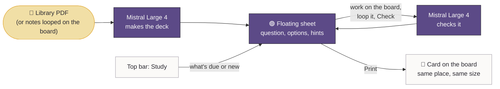

# Noti — Study boards

> **Status: built.** This started as a proposal (PR #28). The decisions from its review are in
> [§1](#1-decisions), and the rest describes how it works now.

A **Study board** is an endless canvas that studies a PDF with you. You link a PDF (lecture notes, a textbook
chapter, past exams) and Noti makes **math and physics** questions, flash cards and problems from it. The current
item floats over the board on a **study sheet**. You work it out with the pen *on the board* and loop your work
to have it checked. **Print** pins the item to the board at the spot and size it had on screen. The sheet then
goes away until the **Study** button in the top bar brings it back.

## 1. Decisions

| Question | Decision |
|---|---|
| Does the sheet have its own writing area? | **No.** You write on the board. To check an answer you loop it, like the Transcribe tool. |
| Model access | **Paste your own API key** (Settings → Study). No server, no account. |
| Model | **Mistral Large 4** (`mistral-large-4`). |
| New kind of notebook, or on every notebook? | **A new kind:** New → Study board. |
| Printed size | **The size it had on screen** when printed. After that it zooms with the board. |
| Subjects | **Math and physics only** for now. The prompts and the typesetting are tuned for them. |

## 2. Using it

**Make a board.** In the library: New → Study board (or the Study boards filter → New study board). A board is an
Endless canvas and starts on grid paper.

**Add your key.** Settings → Study → paste a Mistral API key → Check and save. The key is checked against Mistral
before it's saved.

**Make questions.** Tap **Study** in the top bar, then Make questions. (With an empty deck, Study opens the
dialog straight away.) Pick:

- **From:** a PDF in the library (or Import a PDF…, which adds it to the library too), or *Notes on this board*.
  With notes, you loop handwriting on the board and that becomes the material.
- **Pages:** all of them, or a range.
- **What:** questions, multiple choice, problems, flash cards (a mix by default).
- **How many** (5–40), **level** (review, exam, hard), and an optional **focus** ("projectile motion").

Items stream in while they're being written. The first one opens on the sheet straight away, so you can start
while the rest arrive. Stop keeps what has arrived.

**Study on the sheet.**

- Drag the header to move the sheet. **‹ ›** step through the deck. The pill button collapses it to "Q 3 of 25".
- **Multiple choice:** tap an option. It's checked on the tablet (no network): the right option turns mint, a
  wrong pick turns peach.
- **Flash cards:** Flip, then rate *Again · Hard · Good · Easy*. The sheet moves on.
- **Questions and problems:** work them out on the board, then **Check**. The sheet asks for a loop around your
  work, using the Transcribe loop, and your tool comes back after. Mistral Large 4 reads a picture of the loop and
  answers like a red pen: correct / partly right / not yet, a score, short feedback that points at the first
  mistake, a ✓ or ✗ per step, and what it read.
- **Hint** shows up to three hints, from a nudge to almost the answer. **Answer** shows the answer and the worked
  solution. **Source** shows the cited PDF page. **Place on board** lays that page next to the sheet as a real
  page you can write on.

**Print.** The item's face lands on the board exactly where the sheet showed it, at the same size, with whatever
you'd revealed (hints, answer, the check). A colored edge shows how it went. The sheet disappears. **Study** in
the top bar brings it back on what's **due** for review, else what's **new**.

**Cards on the board.** Tap a printed card (or a placed page, heading or score card) with a finger:

- **Open on the sheet**
- **Move** lifts it back onto the sheet where it was, to drag and print again.
- **Try it again** clears your answer, hints and check, but keeps the review schedule.
- **Remove from the board**

**More, from the sheet's ⋯ menu.**

- **Deck:** every item by topic, with status, what's due, and delete.
- **Questions from notes on the board:** loop some handwriting and get questions from it.
- **Exam:** pick a count, a time and topics. No hints, answers or sources during it. Multiple choice is answered on
  the sheet; the rest is looped and submitted. Results come at the end, and **Print score card** pins the result to
  the board.
- **Arrange cards by topic:** lays printed cards out in columns by topic, with a heading on each.

**Reviews.** Every answer schedules the next review with FSRS, aiming for 90% recall. A right answer without help
is Good. Hints and revealing the answer count against it, and "not yet" comes back in ten minutes. The Study
button and the board's cover in the library show how many items are due.

**Export.** Export PDF includes the printed cards, headings, score cards and placed pages under your ink.

## 3. What leaves the tablet

Only on Study boards, only when you ask, and only to Mistral with your key:

- the PDF (or just the page range) you make questions from. It's uploaded to Mistral's Files API and **deleted**
  as soon as the questions are made.
- a picture of an answer you loop for checking, or of notes you loop to make questions from.

Boards, ink, decks, reviews, multiple-choice checking and printing all stay on the tablet. The key is encrypted
with AES-GCM under an Android Keystore key, is never shown again (only its last four characters), and is excluded
from backups and device transfers (`res/xml/data_extraction_rules.xml`).

## 4. How it's built

| Part | Where |
|---|---|
| Deck, progress, printed cards, headings, placed pages and exams (JSON beside the ink, atomic writes) | `study/Deck.kt`, `study/StudyStore.kt` |
| Spaced repetition (FSRS-4.5, default weights) | `study/Srs.kt` |
| Math typesetting: a LaTeX subset drawn straight to a Canvas | `study/MathText.kt` |
| An item's face, shared by the sheet and printed cards | `study/CardFace.kt` |
| Drawing and hit-testing what's printed on the board | `study/BoardLayer.kt` |
| Mistral client (files, signed URLs, JSON-schema chat completions over SSE) | `study/Mistral.kt` |
| Prompts, schemas, validation, generation and grading | `study/StudyAi.kt` |
| The pasted key | `study/ApiKeyStore.kt` |
| Loop pictures and page-range PDFs | `study/StudyImages.kt` |
| Export | `study/BoardExport.kt`, `pdf/DocumentExport.kt` |
| Sheet, controller, dialogs, Study button | `ui/study/` |
| Settings → Study | `ui/settings/StudySettings.kt` |

**The board** is the Endless canvas (one engine page whose 1000 units span 16 screens). Everything printed is
stored in those page units. That's why it pans and zooms with the ink, and why printing at screen size is exact:
a card stores where its top-left corner is, how wide it was laid out (dp), and how many page units one dp was
when it was printed.

**Under the ink, like paper.** Cards, headings, score cards and source pages are drawn in the canvas's paper layer
(`DocumentBackground`), under the native ink window, so you can write on and around them. Source pages use the
same tiled `PdfDocument` renderer as PDF notebooks.

**The sheet** is a Compose popup (a sub-panel window above the ink window, like the dial). It never covers ink
with a writing area, so the pen's low-latency path is unchanged. Its face is drawn by the same `CardFace` code as
printed cards, which is what makes Print look identical. To print, the sheet's position on screen is converted to
page units.

**Taps.** One-finger taps that the palm filter lets through now reach the canvas (`CanvasGestures.onTap`) and are
hit-tested against what's printed. With finger drawing on, a finger draws instead. Cards are then reached from
the Deck.

**Checking** borrows the Transcribe tool's loop. While the sheet waits for a loop, the Transcribe panel steps
aside, the looped strokes are rendered to a PNG (`StudyImages.inkPng`), and the selection is cleared.

**Mistral.** PDFs go up with `purpose=ocr` and reach the chat as a signed `document_url`. A page range is first
turned into a PDF of page images on the tablet, so only those pages leave it. Replies are constrained to a strict
JSON schema and streamed; each finished item is pulled out of the partial JSON (`PartialJson`) and shown straight
away. Items are validated: multiple-choice options must add up, page numbers are mapped back to the source and
checked, and flash cards drop hints. Each item keeps a short excerpt of its source, so checking an answer never
sends the PDF again.

## 5. Tested, and not yet

Host tests (`./gradlew :app:testDebugUnitTest`) cover:

- the deck round trip and tolerance of broken entries
- FSRS intervals and ratings
- math parsing and layout, including bad input and wrapping
- the Mistral client against recorded replies: multipart upload, signed URL, the request body and schema,
  streamed items across chunk boundaries, deleting the upload even after a failure, grading, error messages
- strict schemas
- board export bounds
- the sheet itself: choosing, hints, flash ratings, printing at the sheet's spot and size, hit-testing printed
  cards, and the phone layout

Screenshots are written to `app/build/reports/study-ui/`.

**Not yet verified:**

- **Live Mistral calls.** There was no key in the build environment. Request shapes follow Mistral's documented
  Files and chat APIs, and are pinned by the recorded-reply tests.
- **The Pad 7.** The sheet as a popup above the ink, loops, and the pen path while the sheet is open still need
  checking on the device.

## 6. Later

- More subjects (chemistry and biology first). Prompts and item kinds are per subject.
- Label-the-figure items (crop a figure from the source, write labels on the board).
- Red-pen marks drawn on the board next to your work, not only on the card.
- A Noti server option for people without their own key.
