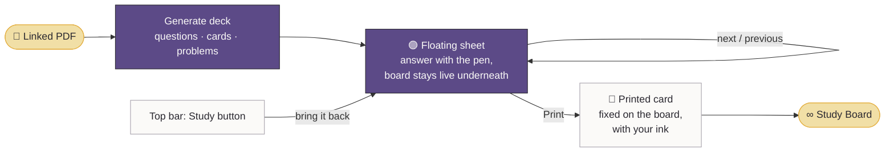
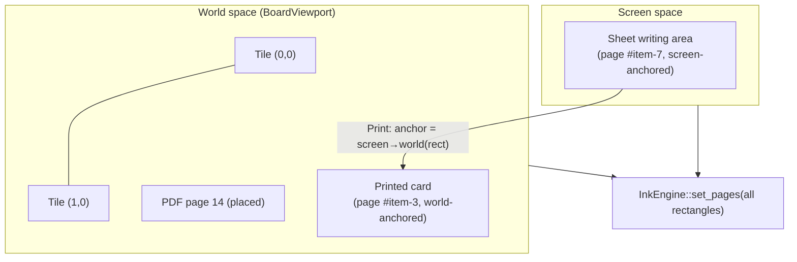

# Noti — Study Board (proposal)

> **Status: draft for review.** Nothing here is built yet. This document describes the idea, expands on it, and
> grounds it in how Noti works today, so we can agree on scope before writing code. Open questions are collected in
> [§9](#9-questions-for-review). Please comment on them.

---

## 1. The idea, as I understand it

A **Study Board** is an endless canvas you can **link to a PDF** (lecture notes, a textbook chapter, a past exam).
Noti reads the PDF and makes **study material** from it: questions, flash cards, worked problems.

You study **inside the canvas**. The current question sits on a **floating sheet**, a small card that hovers over the
board. The sheet has its own writing area, so you can work the problem right there with the pen, and you can still
pan the board underneath to look at your notes, the PDF, or earlier answers. You move between questions on the sheet
without leaving the board.

When a question is worth keeping, you **print** it: the sheet, with the question *and the ink you wrote on it*, drops
onto the board and stays at that spot like a card stuck to a desk. The floating sheet goes away. A **Study** button in
the top bar brings it back with the next question.

So the board slowly turns into a record of how you studied: your notes, the source pages, and the questions you
worked, all in one place.

## 2. What Noti has today, and what changes

| Today | Study Board needs |
|---|---|
| Documents are a **vertical column of pages** (`PageViewport`), A4/Letter, or a PDF. "Endless" paper is a legacy A4 proportion with more pages. | A real **2D endless canvas**: pan in any direction, zoom out far enough to see the whole board. |
| Every stroke belongs to a **page** and is stored in that page's units (`PageMap::kPageUnits = 1000`), so zoom and pan never drift. | Keep that model. It turns out to be exactly what the floating sheet needs (see §6.2). |
| Ink is drawn in a native **input window** over the canvas. Floating controls are sub-panel popups above it (`InkCanvas.kt`). | The floating sheet's writing area must stay *under* the ink window. Only its chrome (header, arrows, buttons) is a popup. |
| A PDF is a notebook (`Notebook.pdf`). | A PDF can be **linked** to a board as a *source*, and its pages can be placed on the board. |
| Handwriting to text runs on the device with ML Kit (`HandwritingReader`). | Reused to read written answers before grading. |
| Fully offline, no account. | Generation needs a language model. **This is the biggest decision in this proposal** (§7.4, Q1). |

## 3. Concepts

| Term | What it is |
|---|---|
| **Board** | A new kind of notebook: an endless canvas. Lives in the library next to notebooks and PDFs, with its own cover. |
| **Source** | A PDF linked to a board. A board can have several (lecture 3 + lecture 4 + the textbook chapter). |
| **Deck** | Everything generated from a board's sources: an ordered set of **items**, grouped by topic. |
| **Item** | One question, flash card or problem. Knows which source pages it came from. |
| **Sheet** | The floating card that shows the current item. It has a writing area and moves over the board. |
| **Print** | Turns the current sheet into a **pinned card** at its spot on the board, ink included. |
| **Pinned card** | A printed item on the board. It can be moved and resized with the lasso, re-opened, or quizzed again. |

## 4. The main flows

### 4.1 Link a PDF and generate

1. In a board, **More → Link a PDF** (or drag one in from the library). Pick one or more PDFs.
2. Noti asks what you want, with sensible defaults:
   - **What to make:** Questions · Flash cards · Problems · A mix *(default)*
   - **How much:** about 10 · 25 · 50 items
   - **Which part:** the whole PDF, or a page range ("pages 12–30"), or *the pages currently on the board*
   - **Level:** Review · Exam · Hard
3. Generation runs in the background. A small progress pill shows in the top bar ("Making 25 questions…"). Items
   **stream in**, so the first question can be opened while the rest are still being written.
4. When it's ready, the **Study** button in the top bar gets a plum dot.

### 4.2 Study on the sheet

1. Tap **Study** in the top bar. The sheet appears over the board, about a third of the screen wide.
2. The sheet shows the question at the top and a writing area below it. Write the answer with the pen. All the tools
   work, including the dial, lasso and eraser.
3. **Drag the sheet's header** to move it. **Pinch the board** (outside the sheet) to pan and zoom underneath it. The
   sheet stays where it is on screen.
4. **‹ ›** in the sheet header go to the previous and next item. Each item keeps its own ink, so going back shows what
   you wrote.
5. Each item has actions in the sheet footer:
   - **Hint** — up to three hints, each a little more direct.
   - **Check** — Noti reads your answer and gives feedback (§5.3). Flash cards just **flip** instead.
   - **Source** — shows the PDF page(s) the item came from (§5.4).
   - **Print** — pins it to the board.

### 4.3 Print

1. Tap **Print**. The sheet plays a short "drop" animation and becomes a pinned card at the same spot, at the board's
   current zoom. The question, your ink and any feedback all come along. It is pixel-identical to what you saw, because
   no ink is copied or redrawn (§6.2).
2. The floating sheet disappears.
3. **Undo** un-prints the card: it goes back to the sheet.
4. Tap **Study** in the top bar to bring the sheet back. It opens on the **next unanswered item**, not the printed one.

### 4.4 Pinned cards on the board

- Lasso a card to move it. It moves as one object, ink included.
- Tap a card's corner badge to **open it again** on the sheet (to keep working on it).
- **Quiz me again** hides your old ink and answer so you can redo it, and then shows the old attempt side by side.
- A card's colored edge shows how it went: mint = correct, butter = partly, peach = wrong, none = not checked.

## 5. Expanding on the idea

These are my additions. I've marked each one **MVP** (part of the first version), **Next** (soon after), or **Later**.

### 5.1 Item types

| Type | On the sheet | Checked by | When |
|---|---|---|---|
| **Short answer** | Question + writing area | Model reads your handwriting | MVP |
| **Multiple choice** | Question + 4 options; circle or tick one with the pen | Locally (no model call) | MVP |
| **Flash card** | Front; tap **Flip** for the back; rate *Again · Hard · Good · Easy* | You | MVP |
| **Worked problem** | Problem + a big writing area (math, steps) | Model reads an image of your work, step by step | Next |
| **Fill the gap** | A sentence from the source with a blank | Locally, with fuzzy matching | Next |
| **Label the figure** | A figure cropped from the PDF; write labels on it | Model reads an image of your labels | Later |
| **Explain it back** | "Explain X in your own words" | Model compares against the source | Later |

Multiple choice is checked on the device: the pen ink is tested against the option boxes, so it works offline and
costs nothing.

### 5.2 Hints instead of answers

Each item comes with up to three hints, from a nudge to almost the answer, and the answer itself behind **Show
answer**. The card remembers how many hints you used. This helps scoring and spaced repetition (§5.6), and
it makes you work it out instead of peeking.

### 5.3 "Red pen" feedback

**Check** sends your answer for grading and the result comes back **as marks on the sheet**, not as a chat bubble:

- a ✓ / ~ / ✗ stamp next to the answer,
- short margin notes pointing at the part that's wrong ("sign flips here"),
- a one-line correct answer you can expand.

Marks are drawn in a distinct "teacher" color on a separate layer, so they never mix with your ink and can be hidden.
When you print, they're printed too.

### 5.4 Source links

Every item cites its source pages. **Source** opens a small preview of that page with the relevant passage highlighted.
From there:

- **Place on board** drops that PDF page onto the board next to the sheet, as a real page you can annotate. This is
  how a board grows: the source pages you actually needed end up next to the questions about them.

### 5.5 Make cards from your own notes (Next)

Lasso anything on the board, like your own handwriting, a region of a placed PDF page or a printed card, and pick
**Make questions from this**. Handwriting is read with the existing Transcribe pipeline first. This means even a board
with *no* PDF can generate a deck from what you wrote.

### 5.6 Spaced repetition (Next)

Flash cards, and optionally all items, are scheduled with a standard spaced-repetition algorithm (FSRS). The **Study**
button shows a count of what's **due today**. The library shows a small badge on boards with due cards. Everything is
scheduled on the device.

### 5.7 Exam mode (Later)

Pick N items and a time limit. The sheet hides Hint and Source, shows a timer, and only grades at the end. The result
is printed as a **score card** on the board, with links to the items you got wrong.

### 5.8 Topic map (Later)

**Lay out by topic** arranges pinned cards on the board in clusters by topic, with a heading for each. It shows at a
glance which topics are mostly peach.

### 5.9 Sheet details

- **Snap** to the left or right edge. Snapped, the sheet becomes a full-height side panel (split view).
- **Resize** from the corner. The writing area grows; the question text reflows.
- **Collapse** to a pill in the corner (like the dial's collapsed button) that shows "Q 4/25".
- The sheet's writing area **scrolls down** when you get near the bottom, so long workings fit.
- Phone layout: the sheet is a bottom sheet at half height.

## 6. How it fits the engine

This is the part that makes me confident the idea works well in Noti specifically.

### 6.1 The endless board

The engine already places ink in **rectangles**, not a fixed layout: `InkEngine::set_pages()` takes a list of
`VisiblePage { page, x, y, width, height }` in screen pixels, and every stroke is stored in its page's own units.
The vertical document is just one way of computing those rectangles (`PageViewport`).

A board is another way:

- The world is cut into square **tiles** (e.g. 2000 × 2000 world units). Each tile is an engine "page". A pen-down picks
  the tile under the nib, as `pick_page()` does today.
- A new `BoardViewport` (2D pan + pinch, like `PageViewport.pan/pinch` but with no column) emits the tiles that are on
  screen, plus placed PDF pages and pinned cards, as `VisiblePage`s.
- Tiles are created when you first write on them, so an empty board costs nothing, and coordinates stay small. Float
  precision is fine wherever you are on the board, because each tile has its own origin.
- **To verify:** a stroke that starts in one tile and crosses into the next must not be clipped at the tile edge. Today
  pages are separate sheets, so clipping never mattered. If the renderer clips per page, boards need tiles to draw
  unclipped.

Zooming far out (say 5%) shows many tiles. The renderer already redraws the dry layer from the store, so cost is
proportional to the ink, not the tile count. A later optimization could draw a cached bitmap of distant tiles.

### 6.2 The sheet is just a page that doesn't move (the key trick)

The sheet's writing area is **one more engine page**, one per item. The only difference from a board tile is where
its rectangle comes from:

- **Floating:** its `VisiblePage` rectangle is fixed **in screen space** (where the sheet is). When you pan the board,
  every other rectangle moves and this one doesn't.
- **Printed:** its rectangle is fixed **in world space**, at the spot it was printed, at that zoom.

So **Print** doesn't copy, convert or redraw any ink. It changes one record from *screen-anchored* to
*world-anchored*, using the current screen-to-world transform. It's instant, exact, and undoable as a single edit
(a new `EditAction` kind). Un-printing does the opposite. Opening a pinned card on the sheet again also does the
opposite.

Because it's still a page, everything else just works: pen, highlighter, eraser, lasso, undo, Transcribe, autosave,
export.

Two details:

- **Input:** the native ink window already covers the whole canvas, so the pen reaches the sheet with no changes.
  The sheet's *header and footer* are popups above the ink window, like the dial today. Its *writing area* has no
  popup over it, so ink stays on the low-latency path.
- **Drawing the question:** the question text, options and any figure crop are drawn *under* the ink, the same way PDF
  tiles are drawn under the ink today (`PageImages.drawPage`). An item's face is a small `PageImages` implementation
  that lays out text in Nunito.

### 6.3 Storage

- **Board ink**: the existing versioned `.noti` archive, with a format bump. Pages gain a kind (`tile`, `pdf-page`,
  `item`) and an anchor (`screen` or `world` + transform).
- **Board layout and deck**: `boards/<id>/board.json` (tiles, placed PDF pages, cards and their state) and
  `boards/<id>/deck.json` (generated items, hints, answers, source page refs, schedule). Written with the same
  write-then-rename pattern as `library.json`.
- **Sources**: linked PDFs are referenced by their library id, not copied again.
- **Export to PDF**: tiles that have ink, placed pages and printed cards are laid out on pages. A sensible first version
  exports one PDF page per screen-sized area of the board that has content.

## 7. Generation and grading

### 7.1 What gets sent

- **Generate:** the PDF itself (or the chosen page range, split out on the device), plus settings (types, count,
  level). Claude reads PDFs directly, including figures, tables and math, so there's no text extraction step on our
  side. Limits are 32 MB per request and up to 600 pages, which covers nearly every lecture PDF. Bigger files are
  split by page range.
- **Hint / Check:** the item, the cited source pages, and the answer. A written answer is sent as **both** the
  on-device transcription (from `HandwritingReader`) **and** a PNG of the sheet's writing area. The text helps with
  prose. The image is what makes math, arrows and diagrams gradable.

### 7.2 Making it cheap and fast

- Upload each source once with the **Files API** and refer to it by id afterwards, so the PDF isn't re-sent for every
  hint and check.
- Put the source document first and mark it for **prompt caching**. Every later call on the same board ("10 more on
  chapter 3", hints, checks) reuses the cached PDF, which is much cheaper and quicker.
- **Structured outputs** (a JSON schema) for decks, hints and grades, so the app always gets valid, typed items.
  Each item carries its source pages in the schema. (The API's citation feature can't be combined with structured
  output, so page numbers live in the schema and are checked on the device against the PDF's page count.)
- **Streaming**, so items appear one at a time.

### 7.3 Model

Default to the most capable current model for generation, since the quality of the questions *is* the feature. Hints,
checks of multiple-choice-adjacent answers and flash-card generation could use a smaller, cheaper model. That's a
cost/quality call for you (Q3).

### 7.4 Privacy and where the key lives

Noti promises "on the tablet, offline, no account". Generation breaks that unless we're careful. Options:

| Option | How | Pros | Cons |
|---|---|---|---|
| **A. Bring your own key** | Paste an Anthropic API key in Settings; stored with Android Keystore; the app calls the API directly | No server, no accounts; simplest; you pay only for what you use | Each user needs their own key |
| **B. Noti server** | A small backend holds the key; users sign in | Works for anyone; can add limits/billing | Accounts, hosting, billing, abuse handling |
| **C. On-device model** | A local model | Truly offline | Far weaker questions; large download; poor at reading PDFs with figures |

My recommendation: **A first** (it ships fastest and keeps "no account"), with every model call behind one
interface, so B can be added later without touching the UI. Either way:

- Generation is **opt-in per board**, and the first time shows exactly what will be sent and where.
- Everything that doesn't need the model stays offline: multiple choice checking, flash cards, spaced repetition,
  printing, the board itself.
- A board with no linked PDF never sends anything.

## 8. Plan

Each phase ships on its own and is useful by itself.

| Phase | What | Why this order |
|---|---|---|
| **0. Board** | New notebook kind with an endless 2D canvas: `BoardViewport`, tiles, library cover, export. No study features. | Everything else sits on it. Useful by itself as a whiteboard. |
| **1. Sheet + Print** | Floating sheet with screen-anchored pages, Print / un-print, Study button in the top bar, pinned cards. Items are **written by hand** for testing, or imported from a simple JSON file. | Proves the core interaction (and the tricky engine part) with no AI and no network. |
| **2. Link & generate** | Link PDFs, generate a deck (short answer, multiple choice, flash cards), streaming, source links, place-on-board. Settings for the key. | The "smart" part. Lands on a proven sheet. |
| **3. Check & hints** | Red-pen grading, hint ladder, card status colors, *Quiz me again*. | Needs answers to exist first. |
| **4. Retention** | Spaced repetition, due counts, *Make questions from this* (lasso). | Turns it from a one-off quiz into a study habit. |
| **5. Extras** | Worked problems, label-the-figure, exam mode, topic map. | Polish and differentiation. |

Tests follow the existing approach. JVM tests cover `BoardViewport` (pan, pinch, anchors) and the screen↔world
anchor maths for print and un-print. Engine host tests cover a page that changes anchor while ink is selected,
undo of print, and strokes crossing tile edges. Robolectric screenshots cover the sheet at tablet and phone sizes.
Model calls are tested against recorded responses, so no network is needed in CI.

## 9. Questions for review

1. **Model access (most important):** bring-your-own-key (A), a Noti server (B), or something else? Is it OK that
   linked PDFs are sent to Anthropic's API when you generate?
2. **Board vs. existing notebooks:** should Study Boards be a **new kind of notebook**, as proposed, or should *any*
   notebook/PDF get the floating sheet (questions over the normal page column, printed into the margin)? A new kind
   is cleaner. Adding it to everything is more reach for more work.
3. **Model cost vs. quality:** best model for everything, or best model for generation and a cheaper one for
   hints/checks?
4. **Printed size:** when printed, should a card keep its **screen size** (so it looks smaller if you were zoomed in),
   or always land at a **standard size** on the board?
5. **One sheet or many:** is one floating sheet at a time right, or do you want to float two items side by side
   (e.g. compare)?
6. **Item mix for the MVP:** are short answer, multiple choice and flash cards the right first three? Is anything
   missing that matters for your subjects (math-heavy? language learning? medicine?)
7. **Language:** generate in the PDF's language, the device language, or let the user pick?
8. **Name:** "Study Board", "Desk", "Study Desk"? (The brand is "a page on a desk at dusk", so *Desk* fits nicely.)
