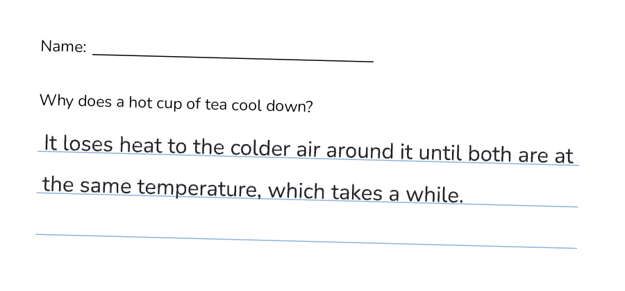
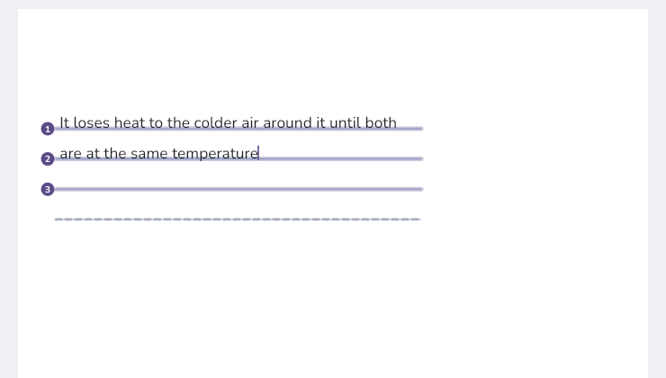
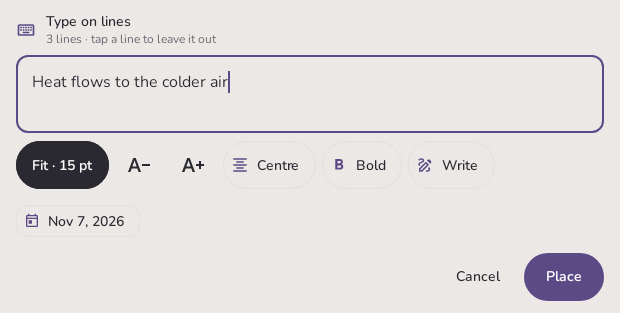
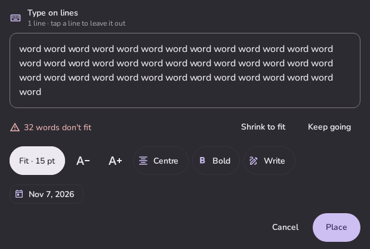
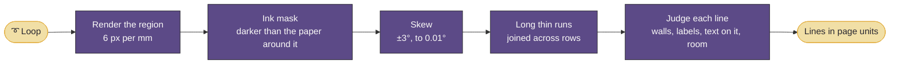

# Noti — Type on lines

You have a PDF with lines on it: a worksheet, a form (`Name: ________`), an exam with answer lines, a scanned
notebook page. Pick **Type** on the dial (the keyboard segment), loop the lines you want, or tap one. Noti finds the
lines there, numbers them, and the text you type lands **on** them: sitting on each line the way handwriting would,
sized to the space between lines, starting after any label, wrapping by words, and never running past a line's end.

It works on scans and photos as well as vector PDFs, on Noti's own lined paper, and on the Endless canvas. It runs on
the tablet, offline, with no account.

  

---

## 1. "Perfectly", as tests

These rules came from the proposal. Each one is now checked by a test (`TypeOnLinesTest`, `LineLayoutTest`). The
end-to-end test renders a worksheet, finds its lines, places the text, and then draws the ink the way the engine
does before checking it.

| Rule | Checked |
|---|---|
| Letters sit **on** the line, never into it | the ink of every word without descenders reaches the line within half a pixel at 6 px/mm, along the whole word |
| Text starts **after a label** and stops **before the line ends** | no capsule of any word passes the line's end; `Name:` blanks start after the label |
| **One size** per block, fitted to the line spacing | the em is 0.62 × the room above the lines, clamped to 2.2–5.2 mm |
| Long text **wraps by words**, no line skipped | lines are used in order; a word longer than a line is split, not dropped |
| A **tilted scan** gets text that follows its lines | a page rotated by 1.5° and a noisy page rotated by 2°; each word is turned with its line |

  
   A worksheet scanned 1.5° crooked, typed onto: the ink the test produced, drawn the way the engine draws it.

## 2. Using it

- **Loop** the lines you want with the Type tool, or **tap** a single line. A loop that covers most of a line takes all
  of it. A loop around part of a long line takes just that part, so you can write on half a line.
- The lines found are **highlighted and numbered**. Lines Noti isn't sure about, such as an underlined heading, a
  frame's top edge or a line that already has words on it, are shown **dashed**. **Tap a line** to leave it out or
  bring it back.
- The **Type panel** opens near the top, out of the keyboard's way. Type in it. The text appears on the page as you
  type, with a caret. **Return** starts the next line.
- **Place** (or Back) puts the text on the page as ink, as one undoable step. **Cancel** drops it.
- **Tap typed text** with the Type tool to reopen it, with its lines, text and style, even after a save or after you
  moved it with the lasso. Edit it and place it again.
- With any other tool, typed text is ordinary ink: erase it, lasso it, export it.

  
   While typing: lines found and numbered, the text as it will be placed, the caret, and a line left out (dashed).

### The panel

  
  

- **Fit · 15 pt** sizes the text to the lines (the default). **A− / A+** set a size instead.
- **Centre** suits short blanks like a date or a score. **Bold** is Nunito Bold.
- **Too much text?** The panel says how many words don't fit, and shows them faded below the lines. It never
  shrinks silently. **Shrink to fit** makes the text smaller on the same lines, down to 1.6 mm. **Keep going** adds
  lines below at the same spacing.
- **Quick fills** are chips that insert at the cursor: today's date, plus anything you save in **Settings → Writing
  → Quick fills** (your name, student number, class). In a form, a fill whose label matches the field's printed label
  comes first.
- **Write** opens a pad where you write with the pen instead. Your writing is read on the tablet by the same
  recognizer as Transcribe and inserted at the cursor, so it lands on the lines as tidy text.
- Keys: **Tab / Shift-Tab** move between fields in a form, **Esc** cancels, **Ctrl+Enter** places.

### Fill this page (PDFs)

**More → Fill this page** finds every blank on the current page and makes each one a **field**. A labelled blank is
one field. Consecutive answer lines with the same ends and regular spacing are one field, and so are the lines of a
box. Fields are softly outlined. **Tab**, **‹ ›** or a tap move between them, and each field is placed as you leave
it. Text you typed before opens in its field, ready to edit. On Android 15 and later, the PDF's own text names the
fields ("Name", "Date"), and a real fillable form's text fields are used as exact fields.

## 3. What counts as a line

| Kind | Example | Where the text goes |
|---|---|---|
| **Rules** | answer lines, notebook scans, light blue or grey rules on shaded paper | on the line |
| **Blanks after a label** | `Name: __________` | on the line, after the label |
| **A label printed on the line** | `Date` sitting on a full-width rule | on the line, after the label |
| **Dotted and dashed** | `Date: ..........`, `- - - -` | on the dots |
| **Tilted** | a phone scan 2° off | along the line, each word turned |
| **Table cells** | a grid | on each cell's bottom border, between its walls |
| **Boxes** | a box to write an answer in | lines about 8 mm apart down the box |
| **Combs** | one box per character (ID numbers) | one character centred in each box |
| **Noti's lined paper** | Lined, Grid and Dots notebooks, the Endless canvas | on the paper's rows, which are known exactly |
| **Nothing at all** | blank paper | **Type here anyway** puts a line along the loop |

## 4. How it works

### 4.1 Finding the lines (`lines/LineFinder.kt`)

The looped region, plus room around it for labels and the line above, is rendered offscreen by the PDF worker at
6 px per mm, ahead of any tile (`PdfDocument.renderRegion`). The detector works on those pixels, so scans and vector
PDFs go through the same code.

1. **Ink**: a pixel is ink when it is darker than its paper by enough. The paper's brightness is measured per block
   of about 4 mm, as the 80th percentile, then the brightest of its neighbours. That way pale rules on a grey scan
   count, and shading doesn't.
2. **Skew**: the angle within ±3° that stacks the ink into the sharpest rows. A coarse search runs every 0.1°, then a
   fine one every 0.01° on every ink pixel. Straight pages give exactly 0. The ink is then sheared so that lines
   become rows.
3. **Lines**: runs of at least 2 mm in a row are joined into one line when they overlap or nearly touch in rows up
   to two apart. A line a hair off the straightened angle steps between neighbouring rows, and its pieces still
   join (connected components over the runs). A line must be 6 mm long and at most 1.6 mm thick. Its course is a
   robust fit: the median top edge of its left half against its right half. **Dotted** lines are chains of five or
   more small marks at one height, regularly spaced.
4. **Judging** each line:
   - **Attachments**: thin marks rising from the line or hanging below it. Evenly spaced teeth make a **comb**. Tall
     walls make **cells**, or a **box** when the cell is over 18 mm tall. A cell ends at its lid, so a table's
     middle border doesn't make its cells look tall. Walls that only hang down make the line a frame's **top
     edge** (unsure). A short mark with stems is a letter's bar, like `T` or `E`, and is dropped.
   - **Text resting on it**: printed text along most of the line makes it an underlined heading (unsure). Text at
     the start and then clear makes a **label on the line**, and writing starts after it.
   - **The label before it**: text just left of the line at its height (`Name:`), kept as a box so the PDF's own
     text can name the field.
   - **Room**: the 25th percentile of the clear space above, up to the text or line above. It sizes the text.

A whole A4 form page (16 blanks) takes about 60 ms on a desktop JVM. A typical loop's region is a fraction of that.

### 4.2 Putting text on them (`lines/LineLayout.kt`, `transcribe/TextInk.kt`)

`LineLayout` is pure arithmetic over a measure function, so the live preview and the ink use the same layout. It
picks one em for the block (0.62 × the median room, clamped), puts each baseline 0.05 em above the line's top edge,
starts at the line's start (or after its label) plus a small inset, and wraps words at each line's own end. Combs
take one character per box. Overflow is reported, shrunk (a binary search for the largest em that fits) or continued
on extra lines.

`TextInk.place` turns the placed words into capsule strokes: the font outline of each word is traced into
capsules, as Transcribe's *Replace on page* already did, turned to its line's slope, and kept as one stroke per word.
They go to `InkEngine::replace_strokes` as a single undoable edit.

### 4.3 The Type tool in the engine

Tool 5 is a loop like Transcribe's, in plum. It selects nothing. It records the loop, or a tap, in **page units**
with its page (`InkEngine::type_loop`), and counts it (document state [10]) so the app notices.
`InkEngine::page_ink(page)` lists a page's visible strokes, which is used to find typed text again. The Type panel
is a popup above the ink window that is **focusable but not touch-modal** (`FLAG_NOT_TOUCH_MODAL`): the keyboard
types into it while the pen still reaches the page around it. Highlights and the live preview are drawn under the
ink, like PDF tiles, so the low-latency path is untouched.

### 4.4 Keeping the words (`lines/TextBlocks.kt`)

Ink alone forgets the text, so each placed block is also saved as a small record in `type/<notebook>.json`, written
with AtomicFile like Study boards. It holds the text, style, em, color, lines, and each word's **mark**: its capsule
count and first point. The engine keeps capsules exactly as given and moves all of a lasso selection by the same
amount. A block is therefore found again when every one of its words is on the page, all offset equally, even
after a reload, when stroke ids change, or after a lasso move. A block whose words were partly erased is no longer a
block, just ink. Duplicating or deleting a notebook copies or deletes its blocks.

Reopening a block hides its ink while you edit it and places the new text when you're done, so editing typed text
is two undo steps. Cancelling puts the original back exactly.

### 4.5 Export

Typed text is ink, so Export PDF includes it as before. It is also written as **real text** in the same font, size
and place at 1/255 opacity, so PDF readers can search and copy it. Only blocks still found on the page are written,
where they are now.

## 5. Decisions on the proposal's questions

The proposal asked nine questions (PR #29). With no answers yet, these are the defaults it recommended, all easy to
change:

| Question | Built as |
|---|---|
| Name and place | **Type**, a 12th dial segment (keyboard icon). The dial's touch targets moved 4 dp outward so the four diagonal ones stay clear of the hub. |
| Ink or text object | **Ink plus a text record**: it behaves like all other ink and stays editable. |
| Fonts | Nunito and Nunito Bold. No handwriting-style font yet. |
| MVP scope | All of it: rules, labels, dotted, tilted, cells, boxes, combs, forms. |
| Searchable export | Yes, best effort (see §6). |
| Overflow default | Warn and let you choose. |
| Keyboard cover | Tab, Shift-Tab, Esc and Ctrl+Enter work. |

## 6. Known limits and not yet verified on the tablet

- **Not tried on the Pad 7 yet.** Everything here is covered by JVM and Robolectric tests, and the APK builds, but
  three things need a real device. First, the panel's window flags: keyboard focus while the pen still reaches the
  page. Second, the speed of rendering and detection on the device. Third, the Android 15 `PdfRenderer` text and
  form-field calls, which are guarded by an SDK check and fall back to nothing.
- **Searchable export** depends on Android's PDF writer keeping near-invisible text. If it drops it, export is just
  as before.
- **Not built**: ticking checkboxes, dragging line ends (loop part of a line instead), and writing values into a
  PDF's own form fields (fields are typed onto as ink, like any other line).
- Detection is tuned on synthetic pages. Real worksheets and scans will surely find cases to tune. Please send
  some.

## 7. Tests

| Test | What it covers |
|---|---|
| `LineFinderTest` | rules, label blanks, labels on lines, dotted and dashed lines, underlined headings, plain text (no lines), table cells, boxes, combs, a noisy 2° scan, faint lines on shaded paper, a whole page's speed |
| `LineLayoutTest` | size, baselines, wrapping, Return, labels, overflow (stop, shrink, keep going), splitting long words, centring, slopes, combs, caret |
| `LinePickerTest` | loops (whole and part lines), taps, reading order, the fallback line, paper lines, form fields |
| `TypeOnLinesTest` | end to end on rendered worksheets, flat and tilted: the ink checked against §1 |
| `TextBlocksTest` | JSON round trip, finding blocks (also moved), not finding broken ones, the store |
| `TypePanelTest` | typing, place and cancel, overflow choices, style, quick fills, Tab and Esc, no lines, and the overlay drawn on a page |
| `TextInkTest` | placed words on their baselines, turned with a tilted line |
| engine `tests.cpp` | the type loop and tap in page units, `page_ink` |
