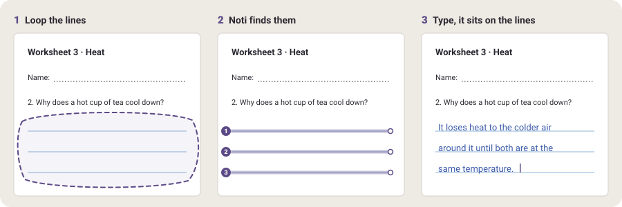

# Noti — Type on lines (proposal)

> **Status: draft for review.** Nothing here is built yet. This document describes the idea, expands on it, and
> grounds it in how Noti works today, so we can agree on scope before writing code. Open questions are collected in
> [§10](#10-questions-for-review). Please comment on them.

---

## 1. The idea, as I understand it

You open a PDF that has **lines on it**: a worksheet, a form ("Name: ________"), an exam with answer lines, a
scanned notebook page. You loop the lines you want to write on. Noti **finds the lines** inside the loop and shows
them to you. Then you **type** (on-screen keyboard, the Pad 7 keyboard cover, or dictation), and the text lands
**on the lines**: sitting on each line the way handwriting would, sized to fit the gap between lines, starting where
the line starts, wrapping onto the next line when one is full, and never running past a line's end.

The result is part of the page. It zooms with it, exports with it, and you can tap it later to change the text.

<p align="center">
  
</p>

"Perfectly" is the whole feature, so here is what I take it to mean, as checks we can test:

| Rule | Target |
|---|---|
| The text's **baseline sits on the line** (on its top edge, not through it) | within 0.5 px at 100% zoom, at any zoom |
| Text **starts after any label** on the line ("Name:") and **stops before the line ends** | never crosses the line's end |
| Text is **sized to the line spacing**, the same size on every line of a block | descenders never touch the line below; ascenders never touch printed text above |
| Long text **wraps to the next line**, by words | no word split, no line skipped |
| A **slanted scan** gets slanted text that follows the lines | within 0.5° |
| It works the same on **vector PDFs and scans** | one detector for both (§6) |

## 2. What Noti has today, and what changes

| Today | Type on lines needs |
|---|---|
| PDFs are drawn by the platform's `PdfRenderer` into tiles (`PdfDocument`). Noti never looks *inside* a page. | Render the looped region once more, offscreen, and **look for lines in the pixels** (§6). |
| **Transcribe** is a lasso (engine tool 4): a loop selects ink and the app gets `selection_ink()`. | A new tool whose loop selects **a region of the page**, not ink. Same gesture, same feel. |
| **Typed ink already exists**: `TextInk` turns text into capsule strokes in Nunito, one stroke per word, and `replace_strokes()` adds them as one undoable edit. | Reused almost as is. The new part is *where* each line of text goes: on detected lines instead of on handwriting lines (§7). |
| `InkLines.group()` finds the lines **of handwriting** to lay text out on. | The same job for **printed lines**. The output (a list of line boxes) has the same shape. |
| Typed ink is just ink: once placed, the words are gone. | A small **text block** record next to the ink, so the text can be reopened and edited (§8.2). |
| Lined paper (`PaperTemplate.Lined`) draws its lines from a formula. | Those lines are known exactly, so on Noti's own lined paper we skip detection entirely (§5.6). |
| Fully offline, no account. | **Stays that way.** Line detection is plain image processing on the tablet. No model, no network. |

## 3. Concepts

| Term | What it is |
|---|---|
| **Type tool** | A new segment on the dial (or a mode of an existing one, Q2). Its loop picks a region to write in. |
| **Line** | A detected writing line: a left end, a right end, a y (or a slope, for scans), and how much clear space is above it. |
| **Blank** | A line that is meant to be written on ("Name: ______", an answer line). Detection tells blanks apart from rules that only *decorate* (table borders, underlined headings, §6.4). |
| **Block** | The lines you looped, in reading order, plus the text you typed on them. One block = one undo step. |
| **Field** | Later: a block that is one blank, found on its own by *Form mode* (§5.3), so you can Tab through a form. |

## 4. The main flows

### 4.1 Loop, check, type

1. Pick **Type** on the dial. Loop the lines you want, the same way you loop handwriting for Transcribe. A loop that
   only grazes a line still counts if most of the line is inside.
2. A moment later (well under 100 ms, §6.5) the lines found are **highlighted in plum and numbered** 1, 2, 3… in
   reading order. The keyboard opens, with a small **Type panel** docked above it, like the Transcribe panel.
3. Type. The text appears **on the lines as you type**, live, in your current pen color. Return goes to the next
   line. Words that don't fit wrap to the next line on their own.
4. **Done** (or tap outside) places it. **Undo** takes the whole block off again.

Quick variant: a **tap** on a single line with the Type tool selects just that line. That's the fastest way to fill
in "Date: ______".

### 4.2 Fixing what was found

Detection will sometimes be wrong. While the panel is open:

- **Tap a highlighted line** to leave it out (it turns grey). Tap again to bring it back.
- **Tap a grey line** that Noti found but wasn't sure about (§6.4) to include it.
- **Drag a line's end handle** to shorten or lengthen it (e.g. to keep text clear of a box on the right).
- **No lines found?** The panel says so and offers **Use as one line**: the loop's bottom edge becomes the line. So
  the tool still works on a page with no lines at all.

### 4.3 When the text doesn't fit

If there is more text than room, the panel shows "**12 words don't fit**" and the overflow is drawn faded below the
last line. You choose:

- **Shrink to fit** — smaller text, same lines (down to a floor, so it stays readable).
- **Keep going** — extra lines at the same spacing, below the block (what Transcribe's *Replace on page* does today).
- Or loop more lines.

My default: show the warning and let you pick; never shrink silently (Q7).

### 4.4 Editing later

Tap typed text with the Type tool and the block reopens: same lines, same text, cursor where you tapped. Edit and
Done; the old ink is replaced in one undoable step. With any other tool it behaves like ordinary ink: erase it, lasso
it, move it.

## 5. Expanding on the idea

These are my additions. I've marked each one **MVP** (part of the first version), **Next** (soon after), or **Later**.

### 5.1 What counts as a line

| Kind | Example | How text goes on it | When |
|---|---|---|---|
| **Full rules** | Answer lines, notebook scans | On the line, left to right, wraps to the next | MVP |
| **Blanks after a label** | `Name: __________` | Starts after the label, on the line | MVP |
| **Dotted and dashed lines** | `Date: ..........` | Same as a solid line (gaps are closed first, §6.2) | MVP |
| **Coloured or faint lines** | Light blue notebook rules, grey worksheet lines | Same; detection uses contrast, not "black" | MVP |
| **Slanted lines** | A phone scan that's 2° off | Text rotated to follow the line | Next |
| **Table cells** | A grid of cells | Text sits on the cell's bottom border, inside the cell's left and right walls | Next |
| **Boxes** | A box to write an answer in | Text inside, from the top-left, wrapping at the box's width | Next |
| **Comb fields** | One box per character (ID numbers, postcodes) | One character centred in each box | Later |
| **Checkboxes** | `☐ Yes ☐ No` | Tap to tick (✓ drawn as ink), no typing | Later |

### 5.2 Style, with sensible defaults

The panel has one row of options, all remembered per notebook:

- **Size: Auto** *(default)* fits the line spacing (§7.1). Or pick a size; all lines of a block share it.
- **Font: Nunito** *(default, the app's font)*. Possibly one more: a neat handwriting-style font (Q4).
- **Color:** your current pen color. The dial's three color slots work while the panel is open.
- **Align:** left *(default)* or centred (nice for short blanks like a date or a score).

### 5.3 Form mode (Next)

**More → Fill this page** finds *every* blank on the page at once and turns each into a field. Then:

- Fields are outlined softly; tap one to type into it.
- **Tab / Shift-Tab** (Pad 7 keyboard cover) and **Next** (on-screen keyboard) move through the fields in reading
  order. This makes filling a long form feel like a web form.
- Labels are read to name fields: the text left of `Name: ____` is in the PDF, and if the PDF has a text layer we can
  read it; otherwise it's just "Field 3".

### 5.4 Quick fills (Next)

Things you type into forms over and over (your name, student number, today's date, your class) as chips in the Type
panel. With Form mode and labels, Noti can **suggest** the right chip: a field labelled "Date" offers today's date
first. Stored on the tablet only.

### 5.5 Write anywhere, land on the lines (Next)

Not everyone wants a keyboard. With the Type panel open, **write with the pen in the panel's scratch area**; it's read
with the existing on-device recognizer (`HandwritingReader`, ML Kit) and placed on the lines as neat text. Your
handwriting never touches the page, only the tidy result. (This is Transcribe's *Replace on page*, but the text goes
on the PDF's lines instead of where you wrote.)

### 5.6 Noti's own lined paper (Next)

On notebooks with **Lined** paper the lines come from a formula, not pixels, so they are exact and need no
detection. The same tool then works on every lined notebook, not just PDFs: loop some lines of the paper and type
your notes onto them.

### 5.7 Real PDF form fields (Later)

Some PDFs are real fillable forms (AcroForm). Android 15's `PdfRenderer` can list a page's form widgets and fill them.
*To verify* on the Pad 7's Android 16. Where a PDF has real fields, Form mode uses them (exact positions, real names,
and the export is a genuinely filled form). Everywhere else, the pixel detector does the work.

### 5.8 Searchable export (Later)

Exported text is drawn as ink today (capsules), so it looks right but isn't selectable in the exported PDF. Since a
block keeps its text (§8.2), export could also write it as invisible real text over the ink, so the exported PDF is
searchable and copyable. Q6.

## 6. Finding the lines

The detector is plain image processing in Kotlin. It runs off the UI thread and never on the ink thread, so writing
latency is untouched. It works on **pixels**, not on PDF drawing commands. `PdfRenderer` doesn't expose the
drawing commands anyway, and working on pixels means scans, photos and vector PDFs all go through the same code.

```mermaid
flowchart LR
    loop(["➰ Loop"]) --> render["Render the looped region<br/>offscreen, ~6 px per mm"]
    render --> mask["Ink mask<br/>contrast vs. local paper"]
    mask --> close["Close small gaps<br/>(dotted → solid)"]
    close --> open["Keep long horizontal runs<br/>(text drops out)"]
    open --> rows["Group runs into lines<br/>ends, y, thickness, slope"]
    rows --> judge["Blank or decoration?<br/>clear space above, labels"]
    judge --> lines(["Lines, in page units"])

    classDef plum fill:#5C4A87,stroke:#2A2830,color:#FBFAF8
    classDef honey fill:#F1DFA6,stroke:#E3AE3F,color:#2A2830
    class render,mask,close,open,rows,judge plum
    class loop,lines honey
```



### 6.1 Render

Render the loop's bounding box (plus a margin, to see labels and line ends just outside it) with the same
`PdfRenderer` call the tiles use, at about **6 px per mm** of paper, capped at 2400 px wide. That's enough to see a
0.1 mm hairline and small enough to stay fast. The renderer is busy drawing tiles, so this goes in its queue at top
priority; the region is usually already rendering anyway.

### 6.2 Mask and clean up

1. **Ink mask.** A pixel is "ink" if it's darker than the paper *around it* by enough (an adaptive threshold over a
   window of ~4 mm). This catches light blue rules on a grey scan as well as black lines on white.
2. **Close gaps.** A horizontal closing a few pixels wide joins the dots of `..........` and the dashes of `- - - -`
   into solid runs.
3. **Keep long runs.** A horizontal opening with a kernel of ~8 mm keeps only marks that are long and thin. Letters
   are short, so printed text mostly disappears and the lines remain. (The underline-like strokes of letters such as
   a long "T" bar are far shorter than 8 mm.)

### 6.3 Group into lines

Each remaining run is a piece of a line. Pieces at the same height, with small gaps between them, are one line.
For each line we record its **left and right ends**, its **y** at the top edge (where text sits), its **thickness**,
and its **slope**, fitted through the pieces. If most lines in the region share a small slope, that's the scan's
skew, and all lines get it (§5.1, *Next*).

### 6.4 Blank or decoration?

Not every horizontal line is for writing on. Each line gets a confidence:

- **Clear space above.** Look at the original mask (with text) in a band above the line, as tall as the gap to the
  next line up. Mostly empty → a blank. Text sitting right on it along most of its length → an **underlined
  heading**, not a blank.
- **A label to the left.** `Name:` just left of the line's start, on the same baseline → a blank; text starts after
  the label.
- **Part of a frame.** A line joined to vertical lines at both ends is a box edge or a table border: a cell or a box
  (§5.1, *Next*). In the MVP, the bottom edges of cells are kept and other frame edges are left out.

Lines we're sure about are highlighted. Unsure ones are shown grey, one tap to include (§4.2). The point is to make
the common case one loop and zero taps, and the uncommon case one tap.

### 6.5 Speed

The region is typically a few hundred thousand pixels. The mask, closing and opening are single passes over it
(run-length based, like `ShapeCapsules` already does for font masks), so detection should take **10–30 ms** on the
Pad 7, plus the render, which is usually already in flight. Target: lines highlighted **under 100 ms** after the loop
closes.

## 7. Putting text on the lines

### 7.1 Size and position

For a block's lines, with **pitch** = the median gap between consecutive lines (or the clear space above, for a
single line):

- **Size**: an em of about **0.62 × pitch**, the same for every line in the block, clamped to a readable range. With
  Nunito's metrics this leaves room for descenders above the next line and ascenders below printed text above.
  A single blank with no line above it uses the clear space above it, and falls back to a normal writing size.
- **Baseline**: the line's top edge, raised by a hair (about 4% of the em) so letters sit *on* the line and don't
  merge into it. Descenders go through the line, like handwriting.
- **Start**: the line's left end, or just after a label, plus a small inset. **End**: the line's right end minus the
  same inset.
- **Slant**: on a sloped line, every glyph's capsules are rotated about the line's start, so text follows the line.

### 7.2 Flowing text

Text is split into words, filled into line 1 until the next word won't fit in that line's own width, then line 2, and
so on. Lines can have different widths (a label on line 1, full width after), and that's handled because each line
wraps at its own end. Return goes to the next line. Overflow is §4.3.

### 7.3 Reusing TextInk

`TextInk` already does the hard part: font outlines → capsule strokes, one stroke per word, in page units. Today
`layout()` takes handwriting `InkLine`s and works out a single size and pitch from them. The change is a second entry
point that takes **explicit placements**: for each line, a baseline start point, a width, an angle, and one shared
size. The capsule tracing (`addPath`, `ShapeCapsules`) is unchanged. The result goes to `replace_strokes()` with no
ids to hide (or the old block's ids, when editing), so it's one undo step and autosaves like any edit.

**Live preview while typing** doesn't go through the engine. Re-tracing capsules on every key press would be wasteful.
The preview is drawn as ordinary text in a Compose overlay at the same positions, and only **Done** traces capsules
once. The overlay and the final ink are laid out by the same code, so they match.

## 8. How it fits the engine and storage

### 8.1 The tool and the loop

The engine already has a lasso that reports a loop (tool 4, Transcribe). The Type tool is a second loop tool: the
engine collects the polygon as it does today, but instead of selecting ink it reports the **polygon itself** (in page
units, with the page number) through a counter like `transcribe_serial()`. The app does the rest. Engine changes are
small: one tool id and one getter for the last polygon. A tap (a tiny loop) reports a point, used for single-line
selection.

The Type panel and the line handles are popups above the ink window, like the dial and the Transcribe panel. The
plum highlights are drawn under the ink, on the page, like PDF tiles. Nothing touches the low-latency drawing path.

### 8.2 Text blocks (keeping the words)

Ink alone forgets the text, so each block is also saved as a small record:

```json
{ "id": "b7", "page": 3, "text": "Alex Moreno",
  "style": { "font": "nunito", "size": 18.4, "color": "#5C4A87", "align": "left" },
  "lines": [ { "x0": 212.0, "x1": 640.5, "y": 318.2, "angle": 0.0 } ],
  "strokes": [ 1041, 1042 ] }
```

- Stored next to the ink: `notebooks/<id>/blocks.json`, written with the same write-then-rename pattern as
  `library.json`. No `.noti` format change is needed.
- `strokes` are the engine ids of the block's words. Tapping one of them with the Type tool reopens the block.
- If you erase some of a block's words with the eraser, the block is **detached**: the rest stays as ordinary ink and
  is no longer editable as text. That's predictable and avoids guessing which words survived.
- Undo and redo of a block's edit also update the record, so they never get out of step.

### 8.3 Export

Typed text is ink, so `DocumentExport` already exports it with everything else. Searchable text is §5.8.

## 9. Plan

Each phase ships on its own and is useful by itself.

| Phase | What | Why this order |
|---|---|---|
| **0. Detector** | `LineFinder` in pure Kotlin: mask, close, open, group, judge. Debug overlay in developer builds. | The risky part, and fully testable without the UI. |
| **1. Type on lines (MVP)** | Type tool on the dial, loop and tap selection, highlights, Type panel with keyboard, live preview, flow and overflow, Done → ink, undo. Full rules, blanks after labels, dotted and faint lines. | The feature you described, end to end. |
| **2. Editable and tidy** | Text blocks (reopen and edit), size/font/align options, line handles, Noti lined paper, skew. | Makes it feel finished rather than one-shot. |
| **3. Forms** | Fill this page, Tab between fields, quick fills, table cells and boxes. | Turns it from a tool into a workflow. |
| **4. Extras** | Write-anywhere (pen → text on lines), checkboxes, comb fields, real AcroForm fields, searchable export. | Polish and reach. |

Tests follow the existing approach:

- **JVM tests for `LineFinder`** on synthetic pages drawn in the test: ruled lines, `Name: ____` blanks, dotted
  leaders, light blue rules on grey, an underlined heading (must *not* be a blank), a table, a page skewed by 2°, a
  page with no lines. Each asserts line ends and y within half a pixel.
- **JVM tests for the layout**: wrapping across lines of different widths, Return, overflow counts, shared size,
  baseline position, and that no capsule crosses a line's end.
- **Engine host test** for the polygon report and tap.
- **Robolectric screenshots** of the Type panel and highlights at tablet and phone sizes, light and dark, like the
  existing UI tests.
- A small set of **real PDFs** (a form, a worksheet, a scanned page) in test resources as end-to-end checks.

## 10. Questions for review

1. **Name.** "Type on lines", "Type", "Fill", "Line writer"? On the dial the segment label is short, so I've used
   **Type** with a keyboard icon.
2. **Where it lives.** A **12th dial segment** (one tap, but changes the dial you've tuned), a **mode of Transcribe**
   (Tt already means "text"), or a **lasso action** ("Type here" after looping)? I lean towards a segment: it's the
   only option that keeps the gesture one loop.
3. **Ink or text object.** I proposed *ink plus a text record* (§8.2): it behaves like everything else on the page
   (eraser, lasso, export) and stays editable. The alternative is a real text object drawn separately: crisper at
   600% zoom and simpler to edit, but it would be the first non-ink thing on a page, and every tool would need to
   learn about it. OK with ink?
4. **Fonts.** Nunito only, or also a neat handwriting-style font (OFL, bundled), so filled forms look handwritten?
5. **MVP scope.** Are full rules, label blanks, dotted and faint lines the right first set, or do **table cells and
   boxes** need to be in the first version for the PDFs you use?
6. **Searchable export.** Worth doing (§5.8), or is "looks right" enough?
7. **Overflow default.** Warn and let you choose (proposed), always keep going below, or always shrink to fit?
8. **Keyboard cover.** Do you use the Pad 7 keyboard? If so, Tab-between-fields (Form mode) could move up to the MVP.
9. **What PDFs first.** Could you share two or three real PDFs you'd use this on (forms, worksheets, scans)? They'd
   become the end-to-end test set, and they'll tell us more about what "lines" means for you than any guess here.
